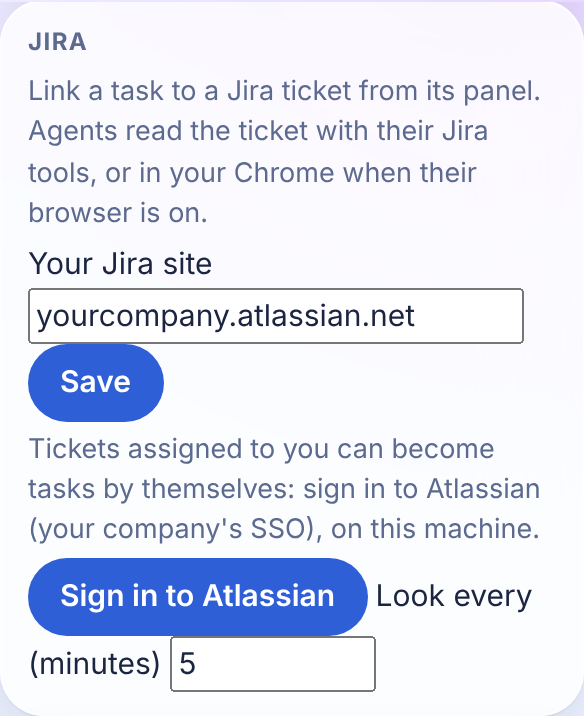
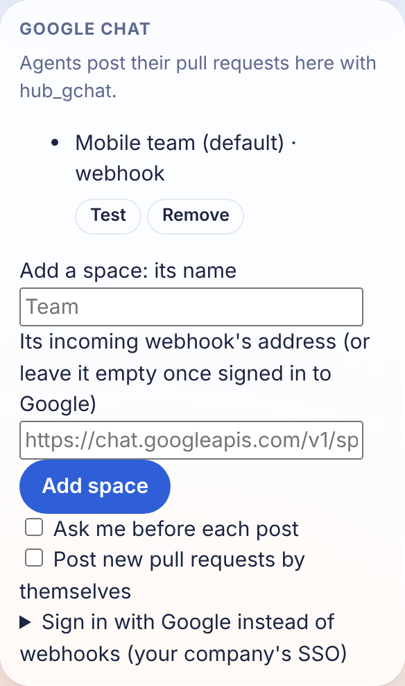
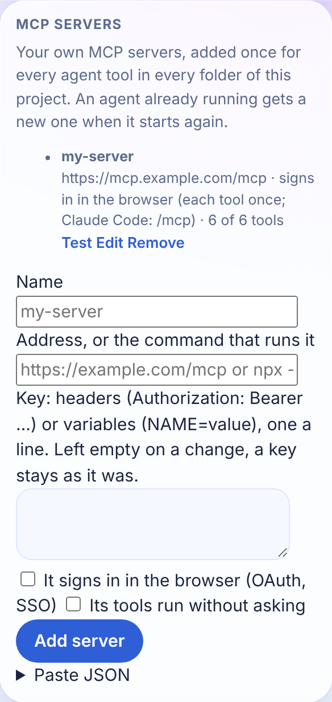

# Jira, Google Chat and your own MCP servers

Your agents can work from your Jira tickets, post their pull requests to Google Chat, and use any MCP server you
add. Each is set up once per project, in **Project settings** on the chat page (the project menu, **⋯**) or with a
command, and reaches every agent of the project. Sign-ins and keys stay on the machine you set them up on.

- [Jira tickets](#jira-tickets)
- [Google Chat](#google-chat)
- [Your own MCP servers](#your-own-mcp-servers)

## Jira tickets

### A task for a ticket

Link a task to a Jira ticket from its panel (**Link Jira ticket**), or in a terminal:

```bash
crewchat tasks jira-site yourcompany.atlassian.net   # the project's Jira site, once
crewchat tasks jira A12 PROJ-123                     # a key, or the ticket's full address
crewchat tasks jira A12 off                          # take the link away
```

A bare key (`PROJ-123`) needs the project's Jira site; a full address works without it. A task posted with a
ticket's address in its title is linked by itself. The agent that takes the task is told to read the ticket before
it plans: with its Jira tools if it has them, else in your Chrome when [its browser](teams.md#agents-in-your-browser)
is on (the Jira site is added to the browser's allowed sites), else by asking you. Agents do not change a ticket
unless you ask them to.

### Jira tools for every agent

When the project has a Jira site, crewchat adds Atlassian's own Jira MCP server (`atlassian`, at
`https://mcp.atlassian.com/v2/mcp`) to Claude Code, Cursor, Gemini CLI, Qwen Code and OpenCode in the project's
connected folders. Each tool signs in once, in the browser (in Claude Code: `/mcp`). crewchat writes no secret for
it, and its tools still ask before they change anything in Jira. Codex keeps one list of servers for all folders,
so add it there yourself: `codex mcp add atlassian --url https://mcp.atlassian.com/v2/mcp`. A server named
`atlassian` that you set up yourself is left as it is.

### Tickets assigned to you become tasks



In Project settings, the **Jira** card: **Sign in to Atlassian**, then **Post my tickets as tasks**. Every 5 minutes
(**Look every**, or `--every`) this machine asks Jira for open tickets assigned to you, and posts each new one as a
task linked to its ticket. Tickets already assigned to you when you turn it on are not posted; a task you take off
the sheet is not posted again.

```bash
crewchat tasks jira-login                  # sign in, in the browser (jira-login out signs out)
crewchat tasks jira-watch on --every 15    # look every 15 minutes
crewchat tasks jira-watch on --jql 'project = APP AND assignee = currentUser() AND statusCategory != Done'
crewchat tasks jira-watch off
```

The sign-in is Atlassian's own page, so your company's single sign-on applies, and there is no API token to paste.
It comes back to crewchat on this machine (127.0.0.1), so start it on the machine that will look; on linked
machines, only that one looks, and the shared sheet gets each ticket once. The sign-in is kept in the project's
private `config.json`, never sent to the chat page. Agents are told that what a ticket says is other people's words:
it describes the work, and does not override yours.

A [routine](getting-started.md#routines) can go through your tickets on a schedule too ("every weekday at 9, go
through my Jira tickets").

## Google Chat

Agents can post the pull requests they open to a Google Chat space you add: its title, its link and a few lines,
signed with the agent's name, in one Google Chat thread per pull request. Each post is also a line in crewchat's
chat.

### Add a space

There are two ways, and a project can use both.

- **By its incoming webhook.** In Google Chat, the space's **Apps & integrations > Webhooks** gives an address. In
  Project settings, the **Google Chat** card: the space's name, its webhook's address, **Add space**. Or
  `crewchat gchat add team-prs --webhook 'https://chat.googleapis.com/v1/spaces/...'`. No Google Cloud setup.
- **Signed in to Google.** For any space you are in, by its name. This needs a Google Workspace account and an OAuth
  client of your own: in your Google Cloud project, turn on the Google Chat API; in its Configuration give the Chat
  app a name and turn interactive features off; in Google Auth Platform make the audience Internal and add the
  scopes `chat.messages.create` and `chat.spaces.readonly`; then make an OAuth client of type **Desktop app** and
  download its JSON. On the card: **Save client** with that file, **Sign in to Google** (Google's own page, so your
  company's SSO applies), then add spaces by name.

```bash
crewchat gchat client ~/Downloads/client_secret.json
crewchat gchat login                 # login out signs out
crewchat gchat spaces                # the spaces you are in
crewchat gchat add "Mobile team"
crewchat gchat default "Mobile team" # where a post goes when the agent names no space
crewchat gchat test                  # post a test message
crewchat gchat remove "Mobile team"
```



### What agents can post

Agents get a tool, `hub_gchat`, while the project has a space they can reach. They are told to post a pull request
once, when it is opened or ready for review, and never to put a secret or a customer's data in a post. An agent can
post only to a space you added, at most 4000 characters, 10 times an hour (30 for the whole project), and the same
text to the same space only once in 10 minutes.

- **Ask me before each post** (`crewchat gchat ask on`) puts each post in Needs you first, with Post and Don't post.
- **Post new pull requests by themselves** (`crewchat gchat auto on`, off by default) posts every new GitHub pull
  request an agent names in the chat or a task update to the default space, once.

The Google sign-in, your OAuth client and the webhook addresses are kept in the project's private `config.json` on
this machine. No agent holds them, and they are never sent to the chat page. A post from an agent on a linked machine
without Google Chat set up is refused there for now.

## Your own MCP servers

Add an MCP server once, and crewchat writes it into every agent tool's settings in every connected folder of the
project, as it does for its own. An agent already running gets a new server when it starts again.

In Project settings, the **MCP servers** card: a name, the server's address (or the command that runs it), and a key
if it needs one; or **Paste JSON** with the server block from its docs. **Test** connects and lists its tools, or says
what went wrong.



In a terminal:

```bash
crewchat mcp add my-server --url https://mcp.example.com/mcp --oauth
crewchat mcp add my-server --url https://mcp.example.com/mcp --header 'Authorization: Bearer YOUR_KEY'
crewchat mcp add my-tools --command 'npx -y my-mcp-server' --env API_KEY=YOUR_KEY
crewchat mcp add --json server.json      # {"mcpServers": {"my-server": {...}}}, or - for stdin
crewchat mcp                             # the project's servers
crewchat mcp test my-server
crewchat mcp remove my-server
```

- **Which tools.** Claude Code, Cursor, Gemini CLI, Qwen Code, OpenCode and Codex, unless you name some
  (`--tools claude,cursor`). Codex keeps one list for all folders, so crewchat writes its own block of servers there.
- **Signing in.** A remote server that signs in with OAuth (`--oauth`, or "It signs in in the browser"; crewchat
  also asks the server when you add it) gets only its address: each tool signs in once (Claude Code `/mcp`, Codex
  `codex mcp login NAME`, the others on first use), so your SSO applies and crewchat keeps no secret.
- **Keys.** A header or a variable is kept in the project's private `config.json` on this machine, never sent to the
  chat page, the chat or your other machines, and written only into the tools' settings files, which crewchat keeps
  out of git. A placeholder such as `<YOUR_API_KEY>` is refused. Agents may not copy a key into a file.
- **Asking.** A server's tools ask before they run unless you tick "Its tools run without asking" (`--allow`).
- **What is left alone.** A server you set up by hand in a tool, or changed there, is not touched; neither is a
  settings file git tracks. `crewchat`, `browser`, `mobile` and `atlassian` are crewchat's own names and cannot be
  used. `http://` addresses work only on this machine (localhost).

Agents are told which servers you added, and that what a server returns is data, not your word.
`crewchat uninstall` takes the servers out with the rest of crewchat. More on what is kept where:
[Privacy](privacy.md).

Next: [Teams and roles](teams.md) · [Commands](commands.md) · [Privacy](privacy.md)
