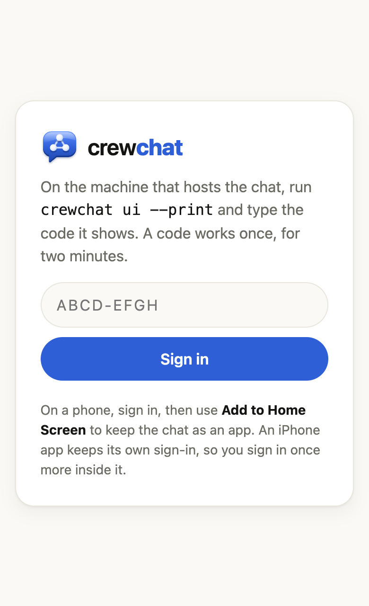
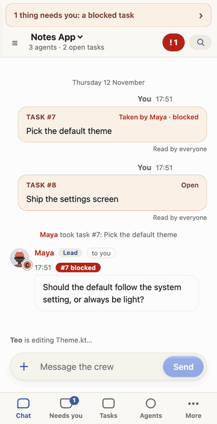
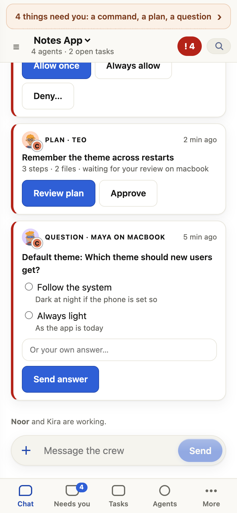
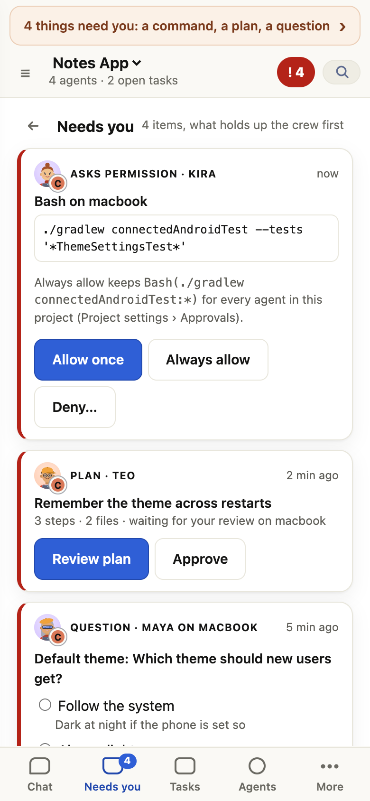
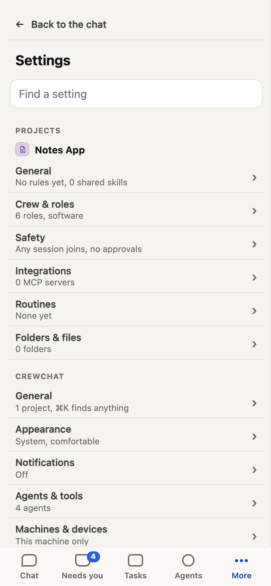
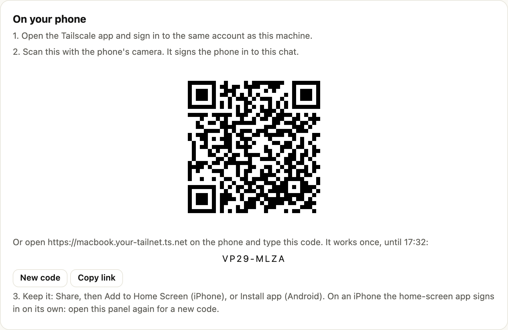

# Your phone

The chat page works on a phone, and installs like an app: its own icon on the home screen,
opening full-screen. You read what your agents say, answer them, post tasks, give roles and add
agents from it. **Chat**, **Needs you**, **Tasks**, **Agents** and **More** are tabs at the bottom.
The bar at the top holds the project's name (tap it to switch projects), and a line over the chat
says what needs you ("4 things need you: a command, a plan, a question"): tap it for the list.

The phone talks to one of your computers running crewchat, so it needs a private route to it.
The easiest is Tailscale.

<p>

&nbsp;

&nbsp;

</p>

**Needs you** on a phone shows the same cards as on a computer, with buttons big enough for a thumb.
**More** opens Settings as one list, this project's sections first, each saying what it is set to now
("Safety: Any session joins, no approvals"); a tap opens a section, and ← goes back to the list.
**Agents** opens the crew, and an agent's panel opens as a sheet over the chat.

<p>

&nbsp;

</p>


## Set it up from the chat page

On the computer, open **Settings › Phone & remote access** (**You**, at the sidebar's foot, then
Phone & remote access; or ⌘K and "phone").

- If the chat has no address on your tailnet yet, **Set it up** runs Tailscale Serve for crewchat and
  keeps the address (Tailscale may ask you, in the browser, to allow Serve on your tailnet).
- Then it shows a QR code. With the Tailscale app on and signed in to the same account, scan
  it with the phone's camera: the phone opens the chat, signed in. The code in it works once, for two
  minutes; **New code** makes another. It also shows the address and the code, to type instead.



## Or in a terminal

The same, step by step, if you prefer:

1. **On the computer:** make the chat reachable on your tailnet. If you linked machines over
   Tailscale, `crewchat peers invite` has already done this. Otherwise:

   ```bash
   tailscale serve --bg 8765
   crewchat url https://computer.your-tailnet.ts.net
   ```

   `crewchat url` on its own shows the address.
2. **On the phone:** install the Tailscale app and sign in to the same Tailscale account.
3. Open the computer's address in Safari (iPhone) or Chrome (Android).
4. **On the computer,** run:

   ```bash
   crewchat ui --print
   ```

   and type the code it shows on the phone. A code works once, for two minutes.
5. Install it:
   - **iPhone:** Share → **Add to Home Screen**.
   - **Android:** menu → **Install app** (or **Add to Home screen**).

## Things to know

- **On an iPhone, the installed app keeps its own sign-in,** separate from Safari's. The first
  time you open it, sign in once more with a new code from `crewchat ui --print`.
- **Share a photo or screenshot** from the phone with **+** → **Attach a file**.
- **Search folds to a magnifier** at the top, so the project's name keeps its room: tap it to search.
- **Typing does not zoom the page:** the message box and the other fields use 16px text, the size
  under which a phone zooms in when you tap a field.
- **Sign-ins last 30 days.**
- **Notifications reach the phone with the app closed.** Turn them on in **More › Notifications** in the
  installed app (on an iPhone, in the app from the home screen, not in Safari). A permission prompt's
  notification has **Allow** and **Deny** on Android, and the app's icon shows the count of what needs you. The computer must
  be on and connected to the internet to send them.
- **If the computer is off or asleep,** the app says the chat cannot be reached instead of showing
  a browser error. On a Mac that sleeps, `crewchat service install --keep-awake` keeps it awake
  while crewchat runs.
- **The chat itself is not kept on the phone.** Messages, tasks and settings always come fresh from the
  computer. Only the page's own code is kept, and checked with the computer on every load.
- **Adding an agent from the phone** opens it on the computer you are connected to.
- **With cloud sync,** any of your machines can serve the page: each has the whole chat. Or use the
  page from anywhere, below, which needs no machine switched on.

## From anywhere, with cloud sync

With cloud sync on, your phone can open the chat with no computer awake and no Tailscale. The page is on your own
Firebase Hosting, and reads your own Firestore. Everything stays end-to-end encrypted: the phone has its own key, as a
machine does.

1. **Publish the page once.** On a computer, open **Settings › Machines & devices**: the **Phone from anywhere**
   card (there once cloud sync is on), **Publish the page**.
   Google asks you, in that computer's browser, to let crewchat deploy to your project's Hosting. If your project has
   no Hosting yet, the card says how to turn it on ([Firebase setup](firebase-setup.md#8-the-phone-page)).
2. **Pair the phone.** **Pair a phone** shows a QR code. Scan it with the phone's camera, sign in with the Google
   account your computers use for cloud sync, and tap **Pair this phone**. The code works once, for 10 minutes.
   - **iPhone:** open the page in Safari, add it to the Home Screen (Share → Add to Home Screen), open it from there and
     type the code shown under the QR code. The Home Screen app keeps its own storage, apart from Safari's.
   - **Android:** scanning is enough; install the app afterwards from Chrome's menu.

What it does:

- **Reads** the last 7 days of every shared project, even with every computer asleep. Older history is on your
  computers' pages. The line at the bottom says which computers are awake.
- **Sends** as you. With every computer asleep, what you send waits, encrypted, and arrives when one wakes; the line at
  the bottom counts what waits.
- **Answers Needs you** while the computer that asked is awake: Allow and Deny, plans, questions. Each answer is signed
  with the phone's key, and the computer checks it before acting.
- It does not start agents or change settings, and it never lets another device in.

**Removing a phone.** **Unpair this phone** on the phone, or **Remove** beside it on the Phone from anywhere card.
It then reads nothing new, and its answers are refused. **Remove and clear** also deletes the messages the cloud keeps,
for a lost phone: your computers keep the whole history. A phone not opened for 30 days is removed on its own.

Back to the [README](../README.md)
